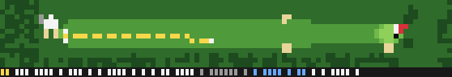
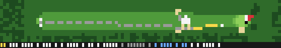

# Custom Claude Code Terminal — Golf

A procedurally generated 8-bit golf course that plays itself in your Claude
Code status line. A 12-handicap golfer works the hole while the agent works,
stands over the ball when it is your turn to type, holes out when the task
finishes, and walks to the next tee while it waits on you. When the agent
spawns subagents, they join as rival golfers on a live leaderboard. The course,
every hole, the caddie, the weather and the season are generated from the
session id and the real calendar.

Everything renders with half-block / sextant cell art in 24-bit colour, so it
works in any modern terminal with zero dependencies beyond Node 18+.

## Quick start

    git clone <this repo> C:/Projects/Custom-Claude-Code-Terminal
    cd C:/Projects/Custom-Claude-Code-Terminal
    bash install/install.sh

Settings hot-reload, so the golfer appears within a second or two; no restart
needed. `bash install/uninstall.sh` reverts everything. The installer edits
`~/.claude/settings.json`: the `statusLine` command, the work/idle hooks, the
subagent hooks, and the golf spinner verbs. It backs the file up first.

Paths are written with forward slashes on purpose. On Windows, Claude Code runs
the status line through Git Bash, which treats backslashes as escapes and would
fail silently.

## Just the spinner verbs (30 seconds, no Node, no status line)

The cheapest piece of this repo, and a good way to try it before installing the
renderer: replace Claude Code's "Thinking…" spinner with 72 golf verbs. Paste
this into `~/.claude/settings.json` and save — it applies on the next turn:

    "spinnerVerbs": {
      "mode": "replace",
      "verbs": ["Teeing off...", "Reading the green...", "Lining up the putt...",
                "Checking the yardage...", "Consulting the caddie...", "Laying up...",
                "Going for it...", "Splashing out...", "Reading the break...",
                "Waggling...", "Punching out of the trees...", "Tapping in..."]
    }

The full list is in `assets/spinner-verbs.json`; the installer loads all 72.
`mode: "replace"` shows only golf verbs (full immersion but it drops Claude
Code's ~190 stock verbs); `mode: "append"` mixes golf verbs into the stock set.
Choose at install time with `bash install/install.sh --append`, or
`--no-spinner` to leave the spinner alone.

Note: verbs are picked at random from the list. Claude Code has no hook for a
dynamic verb, so the spinner can't name what the golfer is doing right now (see
`docs/PROBE.md`, F.5).

## What you see

**Working** (the agent is busy): a framed top-down hole that scrolls to follow
the ball, with mowing stripes on the fairway, clumped rough, bunkers with a
sunlit lip, water, an approach apron into a striped green, the pin with a
wind-reactive flag, a full-hole minimap in the corner, props (tee markers,
bench, ball washer, a 150-yard post, rakes), the golfer, the flight of every
shot as a comet trace, a fixed-width status strip and a scorecard.

**Idle** (the agent is waiting on you): the golfer finishes the shot in the
air, then stands over the ball leaning on the club with the caddie beside him,
or — between holes — walks to the next tee past a scrolling treeline, with the
caddie carrying the bag or the two of them riding a cart.

**Subagents**: when the agent spawns subagents, each becomes a named golfer
playing the same hole, and the scorecard becomes a live leaderboard sorted by
score to par, with you highlighted. It degrades back to the solo view when they
finish.

The status line repaints about once a second (measured; see `docs/PROBE.md`).
Everything advances on wall-clock time with cubic easing, so a late frame just
shows a later moment and motion never stutters into a fixed tick.

## Seasons and weather

The season is read from your system date (northern hemisphere by default) and
is a full palette, prop and weather set, not a tint:

- **Spring** — lush saturated greens, blossom in the treeline, rain showers.
- **Summer** — firm fast links, sandy waste, duller burnt-out turf, high sun.
- **Fall** — russet and gold trees, yellowing turf, leaves blowing across.
- **Winter** — snow with mown lines showing through, an orange ball, bare dark
  trees, a red knit cap and breath puffs.

Golden-hour hours shift the palette warm. Override with
`CCGOLF_SEASON=winter|spring|summer|fall|auto` (default `auto`, `none` to turn
it off) and `CCGOLF_HEMISPHERE=north|south`.

Weather is rolled per hole from the season's probabilities. Rain reads as a
wet, overcast mood with a few faint streaks; snow is prominent; flowers are a
dense warm speckle confined to the rough; a caddie on foot raises an umbrella
in the rain. Force it for a screenshot with
`CCGOLF_WEATHER=rain,overcast` (comma-list, or `clear`).

### Holidays

Near a holiday, the course dresses up: a data file in `assets/holidays/`
layers festive colours, weather and wardrobe on top of the current season for
a short date window. Built in: christmas, halloween, valentines, stpatricks
and independence. The active one is whichever window you are inside with the
nearest start; force or silence it with `CCGOLF_HOLIDAY=<name>` or
`CCGOLF_HOLIDAY=none`. Copy a file and give it a `window` of `"MM-DD".."MM-DD"`
to add your own.

### Camera and segment mode

The hole is drawn in a *raked top-down*: the far side compresses and near
trees stand taller, so it reads like you are looking down the line of play.
`CCGOLF_VIEW=flat` gives the pure top-down, `CCGOLF_RAKE=0..0.9` tunes it.

`CCGOLF_SEGMENT=1` (or passing `--segment`) prints a single clean line —
`H1 par4 356y · tee · E thru 0` — instead of the full picture, so the golf
status can be embedded inside another status line. The hole and the score stay
at every width.

## Glyph tiers and fonts

Each terminal cell can carry more than one "pixel", depending on the Unicode
block your font (or terminal) can draw:

| Tier | Pixels per cell | Glyphs | Support |
|---|---|---|---|
| `halfblock` | 1x2 | U+2580 U+2584 U+2588 | **universal** — every terminal font |
| `quadrant` | 2x2 | U+2596–U+259F | common, but not universal (Consolas lacks it) |
| `sextant` | 2x3 | U+1FB00–U+1FB3B | Unicode 13 "Symbols for Legacy Computing" — recent fonts, or terminals that draw it themselves |

**The default is `halfblock`, and it is the only tier chosen automatically.** A
status line is a one-shot process whose output Claude Code recaptures, so it has
no TTY round-trip to probe your font from the inside — and a safe default beats a
pretty one. `quadrant` and `sextant` are **opt-in**: set `CCGOLF_GLYPHS=sextant`
(or `=quadrant`) once you have confirmed your terminal renders them.

### Check your terminal

    node src/statusline.mjs --doctor

Run it in the terminal where the status line appears. It prints one row per tier
and tells you which render, which terminal and font you are on, and exactly what
to set. **Use the highest tier whose row shows solid two-colour blocks.** If a
row is hollow boxes — `▯ □ ?`, "tofu" — those glyphs are missing and you must
stay lower. (`bash harness/glyphs.sh` is the older dev-only probe.)

### Where sextant works

`halfblock` needs no setup and works everywhere. `sextant` needs **either**:

- **A terminal that draws the glyphs itself**, regardless of font — Windows
  Terminal (`builtinGlyphs`, on by default), kitty, or Ghostty.
- **A font with the Legacy Computing block** — a recent **Cascadia Code**
  (2404.23 / Nov 2024 or newer; older copies, including some bundled ones, do
  not have it) or **GNU Unifont**.

On mintty / Git Bash with the default font, sextant shows tofu — keep
`halfblock` (it looks great), switch to one of the terminals above, or install a
capable font. Note the frames in `docs/frames/` are painted by this project's
own rasterizer, not by a terminal, so they always show sextant no matter what
your terminal can do; `--doctor` shows your reality.

## Themes and row budget

Three built-in course palettes: `CCGOLF_THEME=augusta|links|desert`. Give the
game more of the screen during a long run with `CCGOLF_ROWS` (3–20); the
default scales with your terminal height.

## Try it without Claude Code

    node src/demo.mjs                       # plays a scripted hole in your terminal
    node src/demo.mjs --theme links --glyphs sextant --fps 3 --seconds 40
    node src/demo.mjs --season winter --seed 7

## Customization

Everything below is a data file you can edit without touching source.

### Env vars

| Variable | Effect | Default |
|---|---|---|
| `CCGOLF_THEME` | course palette: `augusta`, `links`, `desert` | `augusta` |
| `CCGOLF_SEASON` | `auto`, `spring`, `summer`, `fall`, `winter`, `none` | `auto` |
| `CCGOLF_HEMISPHERE` | `north` or `south` (for `auto` season) | `north` |
| `CCGOLF_WEATHER` | force weather: `rain`, `overcast`, `snow`, `leaves`, `blossom`, `flowers` (comma-list), or `clear` | rolled per hole |
| `CCGOLF_HOLIDAY` | force a holiday by name, or `none`; see below | `auto` (by date) |
| `CCGOLF_VIEW` | `flat` for pure top-down instead of the raked camera | raked |
| `CCGOLF_RAKE` | camera rake strength, `0`–`0.9` | `0.3` |
| `CCGOLF_SEGMENT` | `1` to emit one embeddable status line (also `--segment`) | off |
| `CCGOLF_GLYPHS` | `halfblock`, `quadrant`, `sextant` (opt-in); `auto` = `halfblock` | `halfblock` |
| `CCGOLF_ROWS` | working-mode height, 3–20 | from `LINES` |
| `CCGOLF_COLOR` | `256` to force 256-colour SGR | truecolor |
| `CCGOLF_SOUND` | `off` to silence all cues | on |
| `CCGOLF_SPINNER_MODE` | `replace` or `append` (install) | `replace` |
| `CCGOLF_HOME` | state directory | `~/.claude/golf` |
| `CCGOLF_TIME_SCALE` | speed up / slow down the sim | `1` |

Set them in the shell, or pin them in `settings.json` under `"env"` (the
installer does this if they are set when you run it).

### Add or edit a theme

Copy a file in `assets/palettes/` and point `CCGOLF_THEME` at its name. Each
file is a list of named colours and a `roles` map saying which colour each game
surface uses. Keep the luminance ladder — darkest to lightest: water, trees,
rough, fairway, green, sand, ball — and check it with:

    node harness/greyscale.mjs

If the hole is not legible in greyscale, the palette is still wrong.

### Change scenery, the treeline and props

Props are sprites in `src/render/props.mjs` (cart, bench, ball washer, post,
rake, markers, birds, tufts) drawn with one light direction. Which props a
season shows is data: the `props` block in each `assets/seasons/*.json`
(`benches`, `ballWasher`, `rakes`, `birds`, `bareTrees`).

### Write a custom season

Add `assets/seasons/<name>.json` with `palette` (role → hex overrides),
`golden` (golden-hour overrides), `weather` (probabilities), `sim` (physics
scaling) and `wardrobe`/`props`. Change which months map to a season in
`assets/seasons/calendar.json`. Select it with `CCGOLF_SEASON=<name>`.

### Edit caddie names and commentary

`assets/text/caddies.json`: `first` and `last` name pools, `golfers` (subagent
names) and `remarks` keyed by situation (`tee`, `rough`, `holed`, `walk`, …).
They read as things a person would actually say; add your own.

### Change the golfer's handicap

`assets/golfer.json`: set `handicap` (1.0 is the stock 12-handicap, 0.6 plays
like a 4, 1.6 like a 20). It scales every dispersion sigma and mistake rate.
You can also edit individual club carries and the `mistakes` rates. Watch the
shot pattern change:

    node harness/montecarlo.mjs 300

### Make it yours: a Scottish links from scratch

1. `cp assets/palettes/links.json assets/palettes/mylinks.json`, edit the
   greens greyer and the rough strawier, keep the ladder, run
   `node harness/greyscale.mjs`.
2. Firmer, windier game: in `assets/golfer.json` nudge `handicap` to `1.1` and
   the club `roll` up; rerun `node harness/montecarlo.mjs 300`.
3. Seaside names: add local names and dry remarks to `assets/text/caddies.json`.
4. `CCGOLF_THEME=mylinks CCGOLF_SEASON=summer node src/demo.mjs` to watch it.

## Requirements

Node 18+, Claude Code, Git Bash on Windows, a terminal with 24-bit colour and
the half-block glyphs U+2580/U+2584 (anything modern). `CCGOLF_COLOR=256` for
256-colour terminals.

## Development

    bash harness/widths.sh          # every row fits COLUMNS-5 at 3 tiers, cat -A verified
    bash harness/perf.sh            # 100-frame spawn timing with a bare-node baseline
    bash harness/glyphs.sh          # which block glyphs your font has
    bash harness/termprobe.sh       # terminal capability report
    node harness/greyscale.mjs      # palette luminance-ladder check
    node harness/scale-check.mjs    # golfer-vs-green proportion across widths/tiers
    node harness/idle-check.mjs     # sim freezes in IDLE, resumes cleanly
    node harness/montecarlo.mjs 300 # handicap profile of the shot model
    node harness/scenes.mjs 100 30  # capture one frame per scene to harness/frames/
    node harness/sprites.mjs sextant# silhouette + colour sprite sheet
    node harness/png.mjs <f.txt> <o.png> [--grey]   # render a captured frame

Layout:

    src/sim/        shot model (data-driven from assets/golfer.json), hole state
                    machine, round/scorecard, subagent golfers
    src/gen/        hole generator, lie classification, caddie + remarks
    src/render/     tiers, subpixel framebuffer, palette, sprites, props,
                    seasons, HUD, scene composition, idle strip
    src/out/        cells backend (ANSI half/quad/sextant); sixel stub
    src/statusline.mjs   entry: load -> advance by wall-clock delta -> render
    src/demo.mjs    scripted hole, no Claude Code needed

## Measured platform behaviour

`docs/PROBE.md` has the full findings. The ones that shape the design:

- `COLUMNS`/`LINES` are set and track the live size; rows past `COLUMNS-5` are
  truncated, so the renderer stays under that.
- Repaints arrive about once a second; `refreshInterval` below 1 disables the
  timer, so the installer sets exactly 1.
- The status line cannot show a bitmap. Claude Code tokenizes captured output
  and re-renders it as cells; only SGR colour and OSC 8 links survive, so Sixel
  and the Kitty protocol are both dropped (confirmed on 2.1.288 and 2.1.296).
  Half-block / sextant cell art is the ceiling, and that is what this is.
- A session started with `NO_COLOR` in its environment renders monochrome; that
  is Claude Code honouring the variable.

## Known limitations

- Subagent lifecycle data (`agent_id`, `agent_type`) is an observed hook
  payload, not a documented contract; if it changes, the leaderboard degrades
  to the solo view rather than breaking.
- Very short terminals drop the frame and scorecard before the picture.

## License

MIT. No audio ships with the repo; see `assets/sound/fetch.md`.
