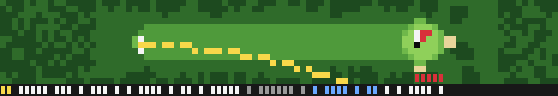

# Custom Claude Code Terminal — Golf

A procedurally generated 8-bit golf course that plays itself in your Claude
Code status line. The golfer works while the agent works, strolls to the next
tee with a caddie while it waits on you, and holes out when the task finishes.

Every hole, every shot, every caddie is generated from the session id. The
golfer plays to a 12 handicap, so he is worth watching.

(Frames above are rendered by `harness/png.mjs` from real status line output;
text rows are shown as blocks there. In the terminal they are text.)

## Install

    git clone <this repo> C:/Projects/Custom-Claude-Code-Terminal
    cd C:/Projects/Custom-Claude-Code-Terminal
    bash install/install.sh

Restart Claude Code (or just wait: settings hot-reload). `bash
install/uninstall.sh` reverts. The installer writes three things to
`~/.claude/settings.json`: the `statusLine` command, a `UserPromptSubmit`
hook and a `Stop` hook. The hooks are how the golfer knows whether the agent
is working; the status line JSON carries no such field.

Paths in `settings.json` use forward slashes on purpose. Git Bash treats
backslashes as escapes and the command then fails with no error anywhere.

Optional: see `assets/sound/fetch.md` for the hole-out sound.

## Requirements

Node 18+, Claude Code, Git Bash on Windows. A terminal that renders 24-bit
colour and the half-block glyphs U+2580/U+2584 (Windows Terminal, mintty,
anything modern). `GOLF_COLOR=256` switches to 256-colour SGR if yours does
not do truecolor.

## What you see

**Working** (the agent is busy): a top-down hole, 4 to 12 rows tall depending
on your terminal height. Tee, fairway, rough, trees, bunkers, water, green,
pin, the golfer, the flight of every shot as an accumulating trace, a wind
arrow, the club, the yardage, and the running score. Short game and putting
switch to a close-up of the green. Big misses get a floating label: SLICE,
TREES, WATER +1, OB +1.

**Idle** (the agent is waiting on you): three rows. The golfer walks to the
next tee with the caddie carrying the bag, or the two of them ride the cart,
past scrolling trees and clouds. Hole number, score to par, caddie name, and a
caddie remark. Before the first prompt the golfer takes practice swings on
the first tee.

**Turn boundaries**: when the agent stops mid-hole, the golfer holes out
immediately (the remaining strokes are simulated with the same model, just
not animated) and the Stop hook plays the putt sound. One prompt is therefore
at least one hole; a long agentic run plays several.

The repaint rate is one frame per second (measured, see `docs/PROBE.md`).
Everything advances on wall-clock time, so a frame that arrives late just
shows a later moment; nothing waits for a frame.

## The golfer

Twelve handicap, tuned with `harness/montecarlo.mjs` (300 rounds):

| Stat | Value | Target |
|---|---|---|
| Average to par | +12.8 | +12 to +15 |
| Greens in regulation | 35% | 30% |
| Fairways hit | 51% | — |
| Three-putts | 17% | 15% |
| Scrambling | 25% | 30% |
| Tee shots in trouble | 16% | 1 in 8 |
| Out of bounds per tee shot | 2.2% | 2% |
| Per 18: birdies / pars / bogeys / doubles | 1.3 / 6.6 / 6.9 / 2.5 | 1 / 6 / 8 / 3 |

Driver carries 250 yards with 7% distance sigma and 7% lateral sigma; one
swing in ten is a slice or hook, one in twenty-five is fat or thin. Wind
moves the ball. Rough and sand cost distance and accuracy. The golfer does
not lay up for water most of the time, which is the entertainment.

## Seeds and reproducibility

- Course layout and each hole: `hash(session_id, hole_number)`.
- Caddie, bag, cart and shirt colours: `hash(session_id)`.
- Each shot: `hash(session_id, round, hole, stroke)`.

Shot outcomes do not depend on frame timing, so a bug report that includes
the session id and the hole number can be replayed exactly:

    GOLF_HOME=/tmp/replay GOLF_MODE=WORKING GOLF_NOW=1700000000000 \
      COLUMNS=100 LINES=30 node src/statusline.mjs <<< '{"session_id":"<id>"}'

Increase `GOLF_NOW` by 700 per call to step through frames.

## Files

| Path | Purpose |
|---|---|
| `~/.claude/golf/state/<session_id>.json` | per-session game state, written temp-then-rename |
| `~/.claude/golf/state/mode` | `WORKING <epoch>` or `IDLE <epoch>`, written by the hooks |
| `~/.claude/golf/state/mode-<session_id>` | optional per-session override, read first if present |
| `~/.claude/golf/career/career.json` | cumulative career: rounds, strokes, best round, score counts |

Session ids starting with `test-`, `bench` or `scene-` never touch the career
file.

## Environment variables

| Variable | Effect |
|---|---|
| `GOLF_HOME` | state root instead of `~/.claude/golf` (the harness uses a temp dir) |
| `GOLF_ROWS` | rows in working mode (3–16); default `clamp(floor((LINES-6)/3), 4, 12)` |
| `GOLF_COLOR=256` | 256-colour SGR instead of 24-bit |
| `GOLF_MODE=WORKING\|IDLE` | ignore the hook mode file |
| `GOLF_TIME_SCALE` | multiply the simulated time per frame |
| `GOLF_NOW` | fixed clock in epoch ms (harness) |
| `GOLF_TRACE=1` | append per-frame timings to `$GOLF_HOME/trace.log` |
| `GOLF_NO_CAREER=1` | never write the career file |

## Development

    bash harness/replay.sh harness/fixtures/working.json 2 60   # watch it live, 2 fps
    bash harness/widths.sh                                      # width matrix, asserts every row fits
    bash harness/perf.sh                                        # 100-frame spawn timing with a bare-node baseline
    node harness/scenes.mjs 100 30                              # capture one frame per scene into harness/frames/
    node harness/png.mjs harness/frames/scene-putt.txt out.png  # frame -> PNG
    node harness/montecarlo.mjs 300                             # handicap profile of the shot model
    node harness/probe-stats.mjs                                # repaint interval statistics from the probe

`harness/replay.sh` and the fixtures use session id `test-golf-0001`; set
`GOLF_MODE` to pick the mode and `GOLF_HOME` to keep test state out of your
real one.

Layout:

    src/sim/golf.mjs       shot physics, dispersion, hole state machine
    src/sim/session.mjs    round, scorecard, mode transitions, idle phases
    src/gen/course.mjs     hole generator, lie classification, caddie, quips
    src/render/raster.mjs  palette-index canvas (two pixel rows per text row)
    src/render/sprites.mjs golfer, caddie, cart, flag, tree sprites
    src/render/scene.mjs   hole view, green view, idle strip, HUD rows
    src/render/palette.mjs assets/palettes/nes16.json -> SGR tables
    src/out/cells.mjs      backend A: ANSI half-block rows, width in cells, reset per row
    src/out/sixel.mjs      backend B: stub, see docs/PROBE.md P0.4
    src/state.mjs          atomic state/career files, mode file
    src/statusline.mjs     entry: load -> advance by wall-clock delta -> render -> persist -> print

## Measured platform behaviour

`docs/PROBE.md` has the full Phase 0 results. The ones that shape the design:

- `COLUMNS` and `LINES` are set for the status line command and track the
  live terminal size. Rows longer than `COLUMNS - 5 - padding` are truncated
  by Claude Code with an ellipsis; the renderer stays at `COLUMNS - 7`.
- Repaints arrive about once a second. `refreshInterval` below 1 silently
  disables the timer, so the installer sets exactly 1.
- Fullscreen rendering clips the status area at about 10 rows on a 30-line
  terminal and 16 on a 40-line one; the row budget above stays under that.
- Sixel never reaches the terminal from a status line command.
- A session started with `NO_COLOR` in its environment renders no colour at
  all; that is Claude Code honouring the variable, not a bug here.
- Node itself takes 35–90 ms to start on a laptop depending on load, so the
  renderer keeps its own work under about 10 ms per frame.

## Known limitations

- The hooks write one shared mode file, so with several concurrent sessions
  every golfer starts playing when any session starts a turn. A hook that
  also writes `mode-<session_id>` fixes it; the renderer already prefers that
  file.
- Clipping in fullscreen mode is driven by `LINES`; a very short terminal
  shows a 4-row course.
- Text in the HUD is ASCII plus the middle dot so width accounting never
  drifts. Emoji would be prettier and would break truncation.

## License

MIT. The hole-out sound is not included; see `assets/sound/fetch.md`.
